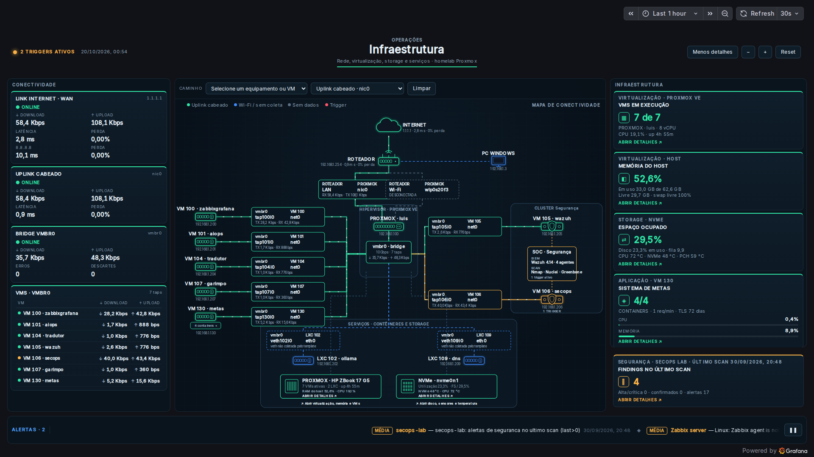
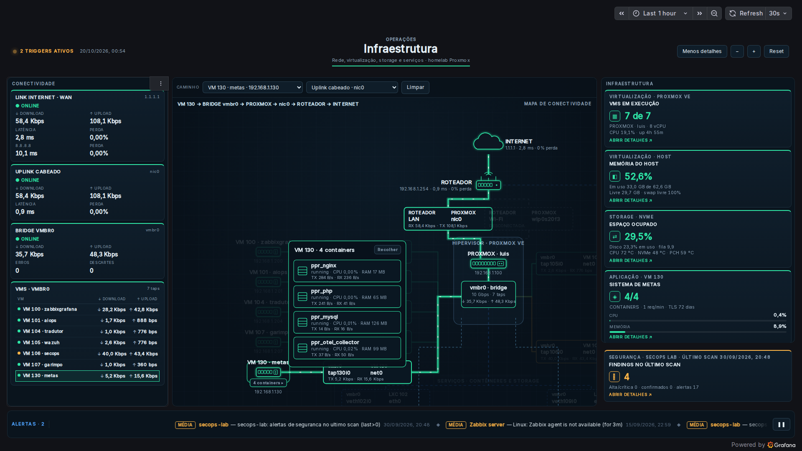
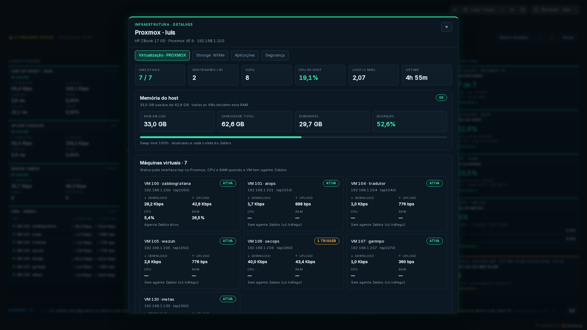

# dashboard-operacoes — Painel de Operações do Homelab (Grafana + Zabbix)

Dashboard interativo de operações do homelab Proxmox no Grafana, no estilo
dos exemplos **Business Charts + Business Text** da Volkov Labs: um mapa de
conectividade em HTML5/SVG com câmera, cartões de enlace e destaque de
caminho, colunas de conectividade e infraestrutura, faixa de alertas e modais
de detalhes com abas, tudo alimentado pelo **Zabbix**.

Este repositório é a fonte da verdade do dashboard: o JSON é **gerado** a
partir do código em `src/` por `gerar-dashboard.py`. Os PRDs ficam em
[`docs/prds/`](docs/prds/).

> **Retomando o trabalho?** Veja [`docs/ESTADO.md`](docs/ESTADO.md): ponto de
> parada, o que está no ar, próximos passos e comandos.

- **URL:** <http://grafana.lan/d/ops-infraestrutura> (ou `http://192.168.1.200:3000/d/ops-infraestrutura`)
- **uid:** `ops-infraestrutura` · pasta raiz · refresh 30 s · janela padrão 1 h
- **Plugins:** `volkovlabs-echarts-panel` 7.2.5 (Business Charts) e
  `marcusolsson-dynamictext-panel` 6.3.0 (Business Text), fixados no
  `GF_INSTALL_PLUGINS` da stack da VM 100



## O princípio

O Zabbix já coleta quase tudo do homelab, mas em telas separadas. Este
painel responde em **uma tela** às perguntas de operação do dia a dia:

- A internet está no ar? Qual a latência e a perda até o gateway e até 1.1.1.1?
- Quais VMs estão rodando e quanto tráfego cada uma passa pela bridge?
- O host aguenta (CPU, memória, disco NVMe, temperatura)?
- Há algum trigger ativo, e onde ele está na topologia?

O mapa mostra o **caminho real** de cada VM até a internet
(VM → tap → vmbr0 → Proxmox → nic0/Wi-Fi → roteador → internet). Ao escolher
uma VM, a câmera voa até o caminho e o resto esmaece.

## Arquitetura

```
┌──────────────────────────── PROXMOX (192.168.1.100) ─────────────────────────────┐
│                                                                                    │
│  VM 100 zabbixgrafana (192.168.1.200)                                              │
│  ┌──────────────────────────┐  API (usuário grafana-ro)  ┌─────────────────────┐  │
│  │ Zabbix 8 server/web       │◄──────────────────────────│ Grafana 13.0.2       │  │
│  │  • agente: Proxmox, VMs   │                            │  dashboard           │  │
│  │    100 e 130              │                            │  ops-infraestrutura  │  │
│  │  • fping: gateway,        │                            │   ├ mapa (Business   │  │
│  │    1.1.1.1, 8.8.8.8       │                            │   │  Charts + SVG)   │  │
│  │  • trapper: secops-lab    │                            │   └ cards/modais     │  │
│  └──────────────────────────┘                            │     (Business Text)  │  │
│                                                           └─────────▲───────────┘  │
└─────────────────────────────────────────────────────────────────────┼──────────────┘
                                                                      │ import via API
                         este repositório ── gerar-dashboard.py ──────┘ (scripts/publicar.sh)
                         src/*.js + estilos.css ──► operacoes-infraestrutura.json
```

### Painéis

| Painel | Plugin | Consulta | O que mostra |
|---|---|---|---|
| Cabeçalho | Business Text | Dashboard (do mapa) | Status dos triggers, título e controles do mapa (Menos detalhes, −, +, Reset) |
| Conectividade | Business Text | Dashboard (do mapa) | Link internet · WAN (latência/perda), uplink `nic0`, bridge `vmbr0` e tráfego de cada VM |
| Mapa | Business Charts (hospedeiro) + cena SVG | Zabbix, 1 h | Topologia, cartões de enlace, clusters, nós de recurso, containers da VM 130 |
| Infraestrutura | Business Text | Zabbix, **24 h** | VMs em execução, memória, storage + temperaturas, Sistema de Metas |
| SecOps | Business Text | Zabbix, **30 dias** | Findings do último scan do secops-lab |
| Alertas | Business Text | Dashboard (do mapa) | Triggers ativos rolando no rodapé |

### Interações

| Ação | Resultado |
|---|---|
| Clique num nó do mapa ou numa VM da lista | Destaca o caminho até a internet; a câmera enquadra o caminho |
| Seletor **Caminho** / **Uplink** | Escolhe o nó e se o caminho passa pelo cabo (`nic0`) ou pelo Wi-Fi |
| Duplo clique num nó | Modal do nó (abas Visão geral / Métricas) |
| **ABRIR DETALHES** (nós largos, cards, caixa SOC) | Modal do Proxmox: abas Virtualização, Storage, Aplicações e Segurança |
| **4 containers ◂** sob a VM 130 | Expande a lista de containers no mapa |
| Roda do mouse / arrastar | Zoom e pan; **Reset** volta à visão geral |





## Decisões

1. **Gerador em vez de editar pela UI.** O JS, o CSS e a topologia ficam em
   arquivos versionados; o JSON é derivado. Edições feitas na UI se perdem no
   próximo import.
2. **Uma consulta, vários painéis.** O mapa consulta o Zabbix e os painéis
   leves usam o datasource "Dashboard" apontando para ele. Só a coluna
   Infraestrutura (24 h) e o card SecOps (30 dias) têm consulta própria,
   porque seus itens gravam raramente.
3. **Cache de métricas entre painéis** (`window.__opsCache`): um modal aberto
   pelo mapa enxerga também os valores que só as consultas de 24 h/30 dias
   receberam.
4. **Senha fora do repositório.** O import roda dentro do container do
   Grafana usando as variáveis de ambiente dele; nada de credencial no git.
5. **WAN por ICMP no próprio Zabbix server** (template oficial ICMP Ping), sem
   agente novo nem serviço externo.

## Estrutura

```
gerar-dashboard.py            hosts, nós da topologia, queries e layout → JSON
operacoes-infraestrutura.json dashboard gerado (não editar à mão)
src/lib.js                    leitura das séries, status, formatação, cache, modal com abas
src/mapa.js                   cena SVG do mapa, câmera, seletores e interações
src/cabecalho.js              status de triggers e controles
src/conectividade.js          coluna esquerda
src/infraestrutura.js         coluna direita
src/secops.js                 card SecOps (30 dias)
src/alertas.js                faixa de alertas
src/estilos.css               CSS global (prefixo ops-)
scripts/publicar.sh           gera, testa e importa no Grafana
scripts/gerar-fixture.py      fixture de teste a partir do Zabbix
scripts/testar-navegador.py   teste de interação com Playwright + prints
tests/harness.js              roda os painéis no Node com contexto falso
docs/                         PRDs, estado, runbook e prints
```

## Uso rápido

```bash
# editar src/ ou gerar-dashboard.py e depois:
scripts/publicar.sh "descrição da mudança"     # gera, roda o harness e importa
LD_LIBRARY_PATH=~/wazuh/.libs/root/usr/lib/x86_64-linux-gnu \
  ~/wazuh/.venv-shot/bin/python scripts/testar-navegador.py /tmp/ops-prints
```

Detalhes, pré-requisitos e troubleshooting: [`docs/runbook-publicar.md`](docs/runbook-publicar.md).

## Roadmap (PRDs)

| PRD | Título | Status |
|-----|--------|--------|
| [001](docs/prds/001-dashboard-operacoes-business-charts.md) | Dashboard de operações com Business Charts + Business Text | **implementado** ✅ |
| [002](docs/prds/002-mapa-svg-padrao-referencia.md) | Mapa HTML5/SVG e modais com abas no padrão do vídeo de referência | **implementado** ✅ |
| [003](docs/prds/003-wan-icmp.md) | Latência e perda da WAN por ICMP | **implementado** ✅ |
| [004](docs/prds/004-proximos-passos.md) | Cobertura completa: agentes nas VMs e LXCs | rascunho |

## Projetos relacionados

- **zabbix-mcp** (`luisfelipecorrea/zabbix-mcp`): stack da VM 100 (Zabbix 8,
  Grafana, compose, backups) onde este dashboard roda.
- **secops-lab** (`luisfelipecorrea/secops-lab`): origem dos findings exibidos
  no card SecOps e na caixa SOC do mapa.
